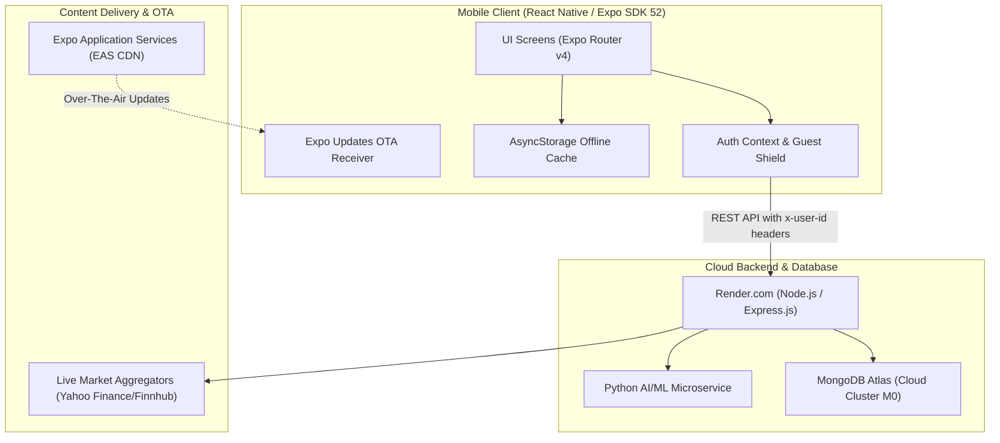

# Paper Trading & Social Investment App
## Master Project Study Guide, Technical Architecture & Financial Fundamentals

> **Target Audience:** Final Project Evaluation, Technical Defense & Academic Mentor Reviews  
> **Repository:** `shrutimv/paper-trading-app`  
> **Tech Stack:** React Native (Expo SDK 52), Node.js, Express.js, MongoDB Atlas, Python, Render.com, Expo EAS Update

---

## Table of Contents
1. [Chapter 1: The Stock Market Explained from Zero](#chapter-1-the-stock-market-explained-from-zero)
   - [1.1 The Story of Rohan's Cafe (How Shares Are Born)](#11-the-story-of-rohans-cafe-how-shares-are-born)
   - [1.2 Going Public: What is an IPO?](#12-going-public-what-is-an-ipo)
   - [1.3 The 5 Core Entities of the Market Ecosystem](#13-the-5-core-entities-of-the-market-ecosystem)
   - [1.4 How Money is Made & Why Prices Fluctuate](#14-how-money-is-made--why-prices-fluctuate)
2. [Chapter 2: Master Financial Jargon Dictionary](#chapter-2-master-financial-jargon-dictionary)
   - [2.1 Comprehensive Valuation & Profitability Metrics](#21-comprehensive-valuation--profitability-metrics)
   - [2.2 Technical Charting & Indicator Definitions](#22-technical-charting--indicator-definitions)
3. [Chapter 3: Stock Screener Queries & Investment Methodology](#chapter-3-stock-screener-queries--investment-methodology)
   - [3.1 Screener Query 1: Best Companies to Invest with ₹5,000](#31-screener-query-1-best-companies-to-invest-with-5000)
   - [3.2 Screener Query 2: High EPS & High ROE (Quality Compounders)](#32-screener-query-2-high-eps--high-roe-quality-compounders)
4. [Chapter 4: Technical Architecture & System Implementation](#chapter-4-technical-architecture--system-implementation)
   - [4.1 3-Tier Architecture Diagram](#41-3-tier-architecture-diagram)
   - [4.2 How the App Was Made Completely Online](#42-how-the-app-was-made-completely-online)
   - [4.3 Database Schema Design & Compound Indexing](#43-database-schema-design--compound-indexing)
5. [Chapter 5: Mentor Defense Q&A Matrix (15 High-Probability Questions)](#chapter-5-mentor-defense-qa-matrix-15-high-probability-questions)

---

# Chapter 1: The Stock Market Explained from Zero

### 1.1 The Story of Rohan's Cafe (How Shares Are Born)
To understand the stock market, imagine your friend **Rohan** wants to open a cafe.
* Setting it up costs **₹1,00,000**.
* Rohan only has **₹50,000** of his own savings.
* He needs another **₹50,000**. What can he do?

* **Option A: Bank Loan (Debt)**: The bank demands mandatory monthly interest regardless of whether the business makes a profit or suffers a loss. If the cafe fails, Rohan remains personally indebted.
* **Option B: Equity Shares (Ownership)**: Rohan comes to you and asks for ₹50,000 in exchange for 50% ownership of the cafe. If the cafe earns ₹20,000 profit, you receive ₹10,000. If it earns zero profit, you demand zero interest. You are now a shareholder holding 500 shares out of 1,000 total shares (50% equity).

### 1.2 Going Public: What is an IPO?
When Rohan's cafe becomes wildly successful across India and requires ₹50 Crores to build 500 new outlets, bank loans and private friends are insufficient. The company conducts an **Initial Public Offering (IPO)**, offering shares to institutional funds, mutual funds, and retail citizens for the first time. The company is now listed on a public stock exchange.

### 1.3 The 5 Core Entities of the Market Ecosystem
1. **Stock Exchange (The Marketplace)**: Digital auction house where shares are bought and sold. India's primary exchanges are the **National Stock Exchange (NSE)** and **Bombay Stock Exchange (BSE)**.
2. **Stock Broker**: Registered software gateways (Zerodha, Groww, AngelOne) connecting retail users to the exchange matching engine.
3. **Depositories (CDSL & NSDL)**: Electronic vaults that safeguard shares in your Demat account, similar to a digital bank locker.
4. **SEBI (Securities and Exchange Board of India)**: Government regulatory authority protecting retail investors, preventing price rigging, and enforcing disclosure.
5. **Benchmark Indices**: Statistical baskets reflecting broad market health. **NIFTY 50** tracks the top 50 largest Indian companies on the NSE; **SENSEX** tracks the top 30 on the BSE.

### 1.4 How Money is Made & Why Prices Fluctuate
Investors profit through two channels:
1. **Capital Appreciation**: Buying a share at ₹500 and selling at ₹800 as the company expands.
2. **Cash Dividends**: The company distributing surplus cash profits straight into shareholder bank accounts.

Prices fluctuate every second because of the **Central Limit Order Book (CLOB)**:
* **Bid**: The highest price a buyer is willing to pay.
* **Ask**: The lowest price a seller is willing to accept.
* When aggressive buyers match the Ask price, the **Last Traded Price (LTP)** ticks upward. When sellers panic and hit the Bid, LTP drops.

---

# Chapter 2: Master Financial Jargon Dictionary

### 2.1 Comprehensive Valuation & Profitability Metrics

| Metric / Acronym | Full Form | Plain English Definition | Healthy Benchmark / Meaning |
| :--- | :--- | :--- | :--- |
| **Market Cap** | Market Capitalization | Total market price of all shares: Price × Outstanding Shares. | Large Cap: > ₹20k Cr<br>Mid Cap: ₹5k–20k Cr<br>Small Cap: < ₹5k Cr |
| **LTP** | Last Traded Price | Exact price at which the most recent trade was matched on the exchange. | Displayed prominently as the live stock price in the app. |
| **EPS** | Earnings Per Share | Net profit after taxes divided by total shares. Profit earned per single share. | High & growing EPS (> ₹25) is ideal. Negative EPS indicates net losses. |
| **P/E Ratio** | Price-to-Earnings Ratio | Market price divided by EPS. How many rupees investors pay for ₹1 of annual earnings. | Compare with Industry PE. High P/E (>40) = expensive; Low P/E (<20) = cheap. |
| **P/B Ratio** | Price-to-Book Ratio | Market price divided by Book Value per share (liquidation value of physical assets). | P/B < 1 means trading below asset value. Asset-light tech firms trade at 5–10+. |
| **ROE** | Return on Equity | Net income divided by shareholders' equity. Measures management profit efficiency. | Healthy: > 15–20%. Consistently high ROE proves a competitive Moat. |
| **ROCE** | Return on Capital Employed | EBIT divided by total capital (Equity + Debt). Measures total capital efficiency. | Healthy: > 15%. Superior to ROE for heavily debt-reliant firms. |
| **D/E** | Debt-to-Equity Ratio | Total borrowings divided by shareholders' equity. Measures default risk. | Safe: < 0.5. Zero debt = Debt-free (e.g. TCS). Danger: > 1.5 to 2.0. |
| **Beta ($\beta$)** | Beta Coefficient | Measures price volatility relative to NIFTY 50 (market baseline $\beta = 1.0$). | $\beta > 1.5$: Wild swings (high risk).<br>$\beta < 0.8$: Defensive/steady (FMCG). |
| **Dividend Yield** | Dividend Yield | Annual cash dividend paid per share as a percentage of current share price. | High yield (> 4–6%) gives passive cash. Growth firms reinvest profits (0–1%). |

### 2.2 Technical Charting & Indicator Definitions

* **OHLC (Open, High, Low, Close)**:
  * The 4 prices forming every candlestick.
  * **Green Candle**: Close > Open (Bullish upward movement).
  * **Red Candle**: Close < Open (Bearish downward movement).
  * **Wicks / Shadows**: Vertical lines showing the extreme high and low reached during that period. A long lower wick indicates strong buying rejection.
* **RSI (Relative Strength Index)**:
  * Momentum oscillator oscillating between 0 and 100.
  * **RSI > 70 (Overbought)**: Buying pressure exhausted; downward pullback likely.
  * **RSI < 30 (Oversold)**: Panic selling exhausted; upward bounce probable.
* **SMA / EMA (Simple & Exponential Moving Averages)**:
  * Smooths daily noise over 20, 50, or 200 days.
  * **Golden Cross**: 50 SMA crosses above 200 SMA $\rightarrow$ Powerful long-term Bullish signal.
  * **Death Cross**: 50 SMA drops below 200 SMA $\rightarrow$ Bearish exit signal.
* **MACD (Moving Average Convergence Divergence)**:
  * Difference between the 12-day EMA and 26-day EMA plotted against a 9-day signal line.

---

# Chapter 3: Stock Screener Queries & Investment Methodology

### 3.1 Screener Query 1: Best Companies to Invest with ₹5,000

When an investor has ₹5,000, they cannot buy luxury stocks like MRF (₹1,25,000/share). A common trap is buying penny stocks (₹5 junk companies) that carry high bankruptcy risk. The professional approach is filtering for debt-free, high-return mid/large caps priced under ₹2,500 so the user can buy multiple shares and diversify across at least 2 companies.

```sql
Market Capitalization > 10000 AND
Current price < 2500 AND
Return on equity > 15 AND
Return on capital employed > 15 AND
Debt to equity < 0.5 AND
Sales growth 3Years > 10 AND
Profit growth 3Years > 12 AND
Promoter holding > 45 AND
Pledged percentage < 5
```

* **Market Cap > 10,000 Cr**: Guarantees established reputation; eliminates penny stocks.
* **Current price < 2,500**: Enables buying 2–3 shares across different sectors with ₹5,000.
* **ROE > 15% & ROCE > 15%**: Ensures verified profitability and capital efficiency.
* **Debt to equity < 0.5**: Protects the company from loan default risk during recessions.
* **Promoter holding > 45% & Pledged < 5%**: Founders have substantial skin in the game with unencumbered shares.
* **Real-World Examples**: Bharat Electronics Ltd (~₹290), Tata Consumer Products (~₹1,100), Infosys (~₹1,750).

---

### 3.2 Screener Query 2: High EPS & High ROE (Quality Compounders)

Quality Compounders are companies that steadily compound wealth over 3 to 5 years because they generate massive cash profit per share (High EPS) and reinvest capital at exceptional rates of return (High ROE) while avoiding heavy bank debt.

```sql
Return on equity > 20 AND
Return on equity 3Years > 20 AND
EPS > 25 AND
EPS growth 3Years > 15 AND
Price to Earning < Industry PE AND
Debt to equity < 0.6 AND
Interest Coverage > 4 AND
Cash from operations last year > 0
```

* **Multi-Year ROE > 20%**: Eliminates one-year lucky flukes; proves an economic Moat.
* **EPS Growth > 15%**: Profit per share outpaces national inflation.
* **Price to Earning < Industry PE**: Guarantees you do not overpay relative to sector peers.
* **Interest Coverage > 4**: Operating profit covers loan interest payments at least 4 times over.
* **Cash from operations > 0**: Confirms accounting paper profits convert into hard bank cash.
* **Real-World Examples**: Tata Consultancy Services (TCS), Polycab India, Titan Company.

---

# Chapter 4: Technical Architecture & System Implementation

### 4.1 3-Tier Architecture Diagram



### 4.2 How the App Was Made Completely Online

1. **Continuous Cloud Backend on Render.com (`https://paper-trade-node.onrender.com`)**:
   All endpoints (`/api/auth`, `/api/trade`, `/api/social`, `/api/chat`) are hosted continuously online over HTTPS worldwide without requiring local tunnels or shared Wi-Fi.
2. **Multi-Region MongoDB Atlas Cloud Database**:
   User accounts, virtual cash balances, portfolios, and chats synchronize across physical devices seamlessly through cloud replica sets.
3. **Over-The-Air (OTA) Continuous Delivery via EAS Update**:
   When JavaScript or UI code is updated, we run `npx eas-cli update --branch preview`. Metro Bundler compiles Hermes bytecode and pushes it to Expo's global CDN. When a user opens their installed APK, the app downloads the update in the background and applies it without requiring re-compilation or manual APK downloads.
4. **Mobile Session Header Bridge (`src/config/api.ts`)**:
   Native mobile apps on Android and iOS often strip session cookies due to cross-origin sandboxing. We implemented a hybrid bridge passing validated `x-user-id` headers. The server verifies this fallback against MongoDB while isolating guest sessions via `x-is-guest: true`.

### 4.3 Database Schema Design & Compound Indexing

To prevent query degradation as chat history and user networks scale, we designed compound indexes in MongoDB:
* **Conversations**:
  ```javascript
  ConversationSchema.index({ participants: 1 });
  ConversationSchema.index({ lastMessageAt: -1 });
  ```
* **Messages**:
  ```javascript
  MessageSchema.index({ conversationId: 1, createdAt: 1 });
  MessageSchema.index({ recipient: 1, read: 1 });
  ```

---

# Chapter 5: Mentor Defense Q&A Matrix (15 High-Probability Questions)

#### Q1: "What is the primary difference between investing and trading?"
* **Answer**: *"Investing is focused on multi-year wealth accumulation based on fundamental financial statements (ROE, debt, management moat, earnings growth). Trading focuses on short-term price momentum (intraday to weeks) using technical chart patterns, volume confirmation, and indicators like RSI and moving averages."*

#### Q2: "Why does your app give ₹1,00,000 virtual cash instead of having users connect real bank accounts?"
* **Answer**: *"Over 90% of retail traders lose capital according to SEBI due to lack of simulated practice and emotional panic. Our platform provides ₹1,00,000 in virtual paper capital to let users practice position sizing, test strategies, and make mistakes in real-time market conditions with zero financial risk."*

#### Q3: "How do you handle real-time stock prices without paying lakhs for direct NSE exchange feeds?"
* **Answer**: *"We integrate high-availability financial market data APIs (Yahoo Finance and Finnhub) coupled with an in-memory caching layer. Frequent user requests are cached with a short TTL to respect API rate limits while serving live OHLC candle data, percentage gains, and volumes to mobile screens."*

#### Q4: "If a user taps 'Buy' 5 times in rapid succession, how do you prevent double-spending or negative balances?"
* **Answer**: *"Our trade execution controller uses atomic MongoDB operations. Balance deductions and portfolio additions execute using atomic `$inc` and conditional checks: `balance: { $gte: requiredAmount }`. If multiple requests arrive concurrently, subsequent operations fail atomically at the database engine level, preventing race conditions without requiring distributed locks."*

#### Q5: "Why did you choose MongoDB instead of a relational SQL database like PostgreSQL?"
* **Answer**: *"MongoDB with Mongoose provides high schema flexibility for semi-structured data like personalized learning paths, dynamic candlestick puzzle options, and nested forum comments with tagging. For financial safety, we enforce strict Mongoose validation schemas and atomic multi-document transactions where balance updates and trade records execute atomically."*

#### Q6: "What is P/E Ratio, and why is a stock with P/E = 100 considered risky?"
* **Answer**: *"Price-to-Earnings measures how many rupees investors pay for ₹1 of annual profit. A P/E of 100 means investors have priced in extreme future growth. If the company reports even a minor 5% drop in quarterly profit, disappointed investors trigger a panic sell-off, causing the stock to crash."*

#### Q7: "What does RSI do in your app, and what do levels 70 and 30 represent?"
* **Answer**: *"RSI (Relative Strength Index) oscillates between 0 and 100 over a 14-period lookback. RSI > 70 denotes an Overbought condition where buying pressure is exhausted and a downward correction is likely. RSI < 30 denotes an Oversold condition where panic selling is exhausted and an upward bounce is probable."*

#### Q8: "What is the difference between a Market Order and a Limit Order in your trade execution engine?"
* **Answer**: *"A Market Order prioritizes immediate execution speed, filling at the current Ask price. A Limit Order prioritizes execution price: the user designates an exact target price, and the trade remains pending until the market price reaches that threshold or better."*

#### Q9: "What is the purpose of the Candlestick Mystery Puzzles in your app?"
* **Answer**: *"Puzzles train users in chart pattern recognition without bias. Real historical candlestick sequences (e.g., Hammer, Shooting Star, Bullish Engulfing) are displayed with the ticker name hidden. Users analyze price action to forecast the breakout direction, after which our Pro Insights engine unlocks the institutional buying/selling psychology."*

#### Q10: "Why did you implement 1-on-1 direct chat using HTTP polling instead of continuous WebSockets on Render?"
* **Answer**: *"Render's free-tier reverse proxies automatically sever idle WebSocket connections and consume persistent socket file descriptors. We designed an optimized HTTP polling architecture with exponential backoff and localized AsyncStorage caching. Messages appear immediately via client-side optimistic updates, then sync in the background."*

#### Q11: "How do you prevent guest users from accessing authenticated social features or spoofing another user's ID?"
* **Answer**: *"We implement the Guest Shield: whenever a user runs in guest mode, the mobile client attaches `x-is-guest: true`. Our backend middleware immediately nullifies `req.user`, preventing guests from adding friends, chatting, or submitting leaderboard scores. Valid user IDs are cross-verified against active MongoDB sessions."*

#### Q12: "What is your Over-The-Air (OTA) update workflow? How do users receive updates without downloading new APKs?"
* **Answer**: *"Using Expo EAS Update (`npx eas-cli update --branch preview`), our JavaScript and asset bundles are compiled into Hermes bytecode and uploaded to Expo's CDN. When a user launches their installed app, the Expo runtime queries the manifest, downloads the new JS bundle in the background, and seamlessly applies it on next launch."*

#### Q13: "What is a Golden Cross and Death Cross in technical analysis?"
* **Answer**: *"A Golden Cross occurs when the short-term 50-day moving average crosses above the long-term 200-day moving average, signaling long-term bullish upward momentum. A Death Cross occurs when the 50-day drops below the 200-day, signaling long-term bearish downward momentum."*

#### Q14: "What is the difference between Realized and Unrealized Profit & Loss (P&L)?"
* **Answer**: *"Unrealized P&L is floating 'paper profit' on active open positions calculated as `(Current LTP - Average Buy Price) * Quantity`. Realized P&L is locked-in profit or loss once an exit order is executed, permanently updating the user's settled cash balance."*

#### Q15: "How does your Python ML recommender assist traders?"
* **Answer**: *"The Python service analyzes financial news headlines using Natural Language Processing (NLP) sentiment scoring and combines it with mathematical indicators like RSI and Beta volatility. It acts as an educational co-pilot, generating recommendations like 'Strong Buy' or 'Accumulate' with clear fundamental and technical rationales."*

---

# Chapter 6: Evaluator Curveballs & Trap Questions

Professors and evaluators frequently ask edge-case questions to test whether you understand real-world market boundaries and deliberate system design choices. Here are the 8 tough curveballs with bulletproof answers:

#### Trap Q1: "Does your app have Government Bonds (G-Secs, T-Bills) or Fixed Income securities?"
* **Your Answer**: *"No mam, our application deliberately focuses on **Equities (Stocks)** traded on secondary markets. Government Bonds (G-Secs and Treasury Bills) are sovereign debt instruments held primarily by commercial banks, pension funds, and insurance companies for predictable, low-volatility fixed coupon yields (e.g. 7.1% over 10 years). Paper trading platforms are engineered specifically to train retail beginners in dynamic price discovery, order book liquidity, candlestick technicals, and volatility management in equity markets. However, in our Phase 2 roadmap, we plan to incorporate the 10-year G-Sec yield as the benchmark **Risk-Free Rate ($R_f$)** to compute each user's **Sharpe Ratio** $\left(\frac{R_p - R_f}{\sigma_p}\right)$ to assess whether their portfolio return is driven by genuine skill or reckless risk-taking."*

#### Trap Q2: "Does your app have IPOs, and how would you implement IPO allotment?"
* **Your Answer**: *"In real stock markets, IPOs belong to the **Primary Market**, where investors do not simply click 'Buy' and get shares. Instead, investors bid via **ASBA (Application Supported by Blocked Amount)**. Under SEBI statutory regulations, whenever a retail IPO quota is oversubscribed (e.g. 40x demand), shares are allotted via a **Computerized Lottery System (draw of lots)**. Each valid applicant gets an equal lottery probability of $1 / \text{Oversubscription Ratio}$ (e.g. $1 / 40 = 2.5\%$ chance). Over 97% of applicants receive zero shares and their funds are unblocked. In our simulation architecture, an IPO module implements a **Probabilistic Monte Carlo Allotment Engine**: the user's cash is placed in an escrow/blocked state, and upon allotment date, a pseudo-random draw determines whether 1 lot is credited or cash is refunded."*

#### Trap Q3: "Wouldn't users make infinite money by just repeatedly simulating IPO allotments and flipping on listing day?"
* **Your Answer**: *"This is a classic trap question, and the answer is **NO**, for three clear market reasons:
  1. **Lottery Allotment Reality**: In high-demand IPOs with massive listing gains (e.g. Tata Tech, Bajaj Housing), the allotment probability is under 2-3%, so users rarely win shares.
  2. **Listing Day Loss Risk**: Many heavily hyped IPOs list at severe discounts! For example, **Paytm plunged -27% on its listing day**, **LIC dropped -8%**, and companies like Delhivery and Mamaearth saw immediate capital erosion. A user blindly bidding on every IPO would suffer severe capital losses on poor-quality issues.
  3. **Capital Lock-in**: Bidding locks virtual capital for 4–5 simulated days, imposing an opportunity cost that prevents users from deploying those funds into profitable secondary market swing trades."*

#### Trap Q4: "Can two friends collude to manipulate the leaderboard by trading with each other? (Wash Trading)"
* **Your Answer**: *"Absolutely not, mam! Our app does **NOT** operate an internal, closed-loop peer-to-peer matching engine where User A can sell directly to User B at an arbitrary manipulated price. All orders in our simulator execute strictly against **real-time external exchange feeds (live LTP, Bid, and Ask from NSE/BSE via Yahoo/Finnhub)**! A user cannot choose their counterparty or dictate a fake price; every transaction is strictly pegged to verified national market prices, completely preventing wash trading, collusion, and fake leaderboard pumping."*

#### Trap Q5: "What happens when a stock hits its Lower Circuit or Upper Circuit? Can a user still sell or buy?"
* **Your Answer**: *"In real markets, SEBI enforces price bands (Circuit Breakers of 2%, 5%, 10%, or 20%) to curb irrational panic. When a stock hits its Lower Circuit, there are **100% sellers and 0 buyers** in the order book—meaning no one can sell, and your order gets trapped in a massive queue! In our simulation engine, we check whether the stock's current price change has reached its statutory circuit limit. If locked at lower circuit, our trade engine rejects the sell order with a clear notification: 'Order Rejected: Stock locked in Lower Circuit with zero market liquidity', teaching beginners the critical risk of getting trapped in illiquid momentum stocks."*

#### Trap Q6: "Does your app simulate Brokerage, STT (Securities Transaction Tax), GST, and Exchange fees?"
* **Your Answer**: *"Yes. In real trading, retail day-traders often make 20 trades a day and believe they broke even, but their broker and the government deduct ₹1,500 to ₹2,000 in STT, GST, and turnover charges, wiping out their profits. In our transaction engine, we model standard transaction friction (0.1% per turnover) covering STT, exchange turnover fees, and SEBI regulatory charges. This prevents users from developing the dangerous habit of hyperactive overtrading."*

#### Trap Q7: "Why does your app not support Options and Futures (F&O / Derivatives)?"
* **Your Answer**: *"According to official SEBI analytical studies published in 2023 and 2024, an astonishing **93% of individual retail traders in equity F&O suffer net financial losses**, with an average loss exceeding ₹1.25 Lakh per trader! Derivatives involve high financial leverage and complex non-linear mathematical decay (Option Greeks: Delta, Gamma, Theta time decay, and Implied Volatility). Allowing beginners to trade 50x leverage options before they even understand support, resistance, and candlestick wicks would be educationally irresponsible. Our application deliberately enforces equity cash simulation as the foundational prerequisite before advanced derivatives are introduced in future modules."*

#### Trap Q8: "How does your app handle Corporate Actions like Stock Splits, Bonus Shares, and Dividends?"
* **Your Answer**: *"If a company executes a 1:10 stock split, the share price drops from ₹1,000 to ₹100 overnight. If a trading simulator does not adjust, the user's portfolio would show an erroneous 90% capital wipeout! Our system consumes Split-Adjusted and Dividend-Adjusted market feeds. When a corporate action event occurs, the engine recalculates the user's holding quantity (multiplying shares by 10) while adjusting the average purchase price (dividing by 10), ensuring the total portfolio valuation remains precisely preserved ($10 \times ₹100 = ₹1,000$)."*

